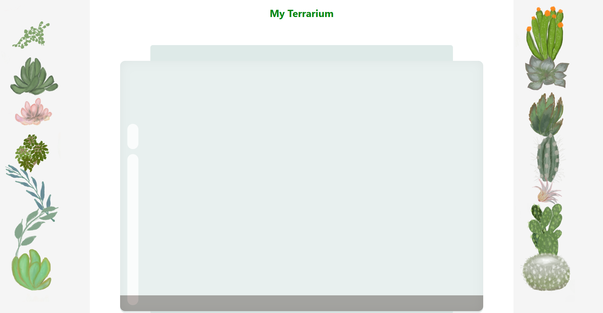
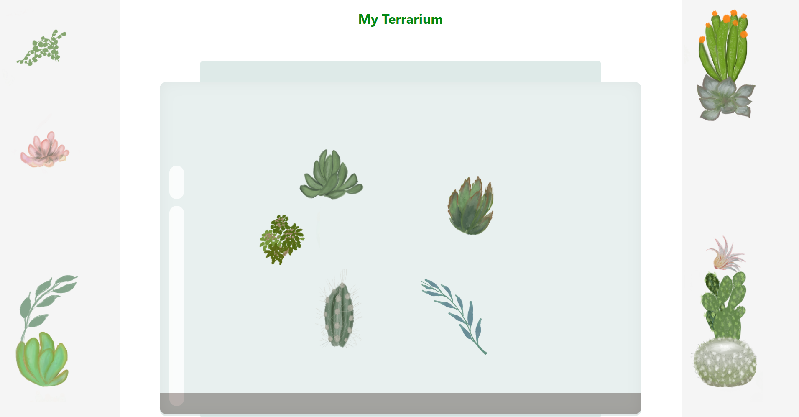

# Virtual Terrarium

A simple interactive virtual terrarium built with **HTML, CSS, and JavaScript**. The project recreates a glass terrarium containing different plants, allowing users to arrange the plants by dragging them around the page.

## Preview


## Features

- **Interactive plants:** Drag and reposition plants using pointer interactions.
- **Terrarium design:** A glass jar with soil, reflections, and decorative styling.
- **Plant collection:** Includes 14 different plant images.
- **Visual effects:** CSS hover effects and styling enhance the appearance.
- **Interactive functionality:** Plant dragging works through pointer events.

## Technologies Used

- **HTML5** – Structures the terrarium and its elements.
- **CSS3** – Handles layout, positioning, styling, and visual effects.
- **JavaScript** – Adds interactive plant-dragging functionality.
- **Git & GitHub** – Used for version control and project management.

## Project Structure

```text
terrarium/
│
├── images/          # Plant images and visual assets
├── index.html       # Main HTML page
├── style.css        # Styling and layout
├── script.js        # Interactive functionality
└── README.md        # Project documentation
```
## Preview




## How to Run Locally

1. Clone the repository:

   ```bash
   git clone https://github.com/crackedphos/terrarium.git
   ```

2. Open the project folder:

   ```bash
   cd terrarium
   ```

3. Open `index.html` in your web browser.

No additional dependencies or installation steps are required.

## What I Learned

Working on this project helped me develop a better understanding of how HTML, CSS, and JavaScript work together to create an interactive web application.

### 1. HTML Structure and Organisation

I learned how to structure a web page using HTML5 and organise different elements into meaningful sections. This included:

- Creating and organising page elements using HTML tags.
- Using classes and IDs to identify and target specific elements.
- Linking external CSS and JavaScript files to an HTML document.
- Organising images and other assets within a project directory.

### 2. CSS Styling and Layout

I gained practical experience using CSS to control the appearance and positioning of elements on a web page. This included:

- Applying colours, backgrounds, borders, and other visual properties.
- Using positioning techniques to arrange plants around the terrarium.
- Styling the glass jar to create reflections, transparency, and a more realistic appearance.
- Using hover effects to make elements respond visually to user interaction.
- Understanding how different CSS properties work together to create a consistent design.

### 3. JavaScript and DOM Manipulation

This project introduced me to using JavaScript to make web pages interactive rather than purely static. I learned how to:

- Select HTML elements using JavaScript.
- Attach event listeners to respond to user actions.
- Use pointer events to detect when a user interacts with an element.
- Update element positions dynamically based on pointer movement.
- Use functions to organise and reuse code instead of repeating the same logic.

### 4. Interactive Drag-and-Drop Functionality

One of the main learning experiences was implementing the functionality that allows users to move plants around the terrarium.

Through this, I gained experience with:

- Detecting when a user presses or clicks on a plant.
- Tracking pointer movement while an element is being dragged.
- Updating an element's position based on the pointer's coordinates.
- Detecting when the user releases the pointer to finish dragging.
- Applying the same functionality to multiple plant elements.

This helped me understand how JavaScript can respond to user input and manipulate elements on a web page in real time.

### 5. Combining Frontend Technologies

I developed a better understanding of how HTML, CSS, and JavaScript work together:

- HTML provides the structure and content.
- CSS controls the appearance and layout.
- JavaScript handles interaction and behaviour.

The project helped me understand how these three technologies complement one another when building a functional frontend application.

### 6. Version Control and Project Management

I also gained experience working with Git and GitHub to manage my project. This included:

- Creating and maintaining a GitHub repository.
- Tracking changes made to project files.
- Using commits to record development progress.
- Organising project files to make the codebase easier to understand and maintain.
- Writing a README to document the project and explain how others can run it.


## Future Improvements

- Improve the layout for smaller screens and mobile devices.
- Add more plant varieties and customization options.
- Allow users to reset the terrarium to its original arrangement.
- Add functionality to save plant arrangements.
- Improve accessibility and keyboard interaction.

---

**Developed by [Mpho](https://github.com/crackedphos)**
